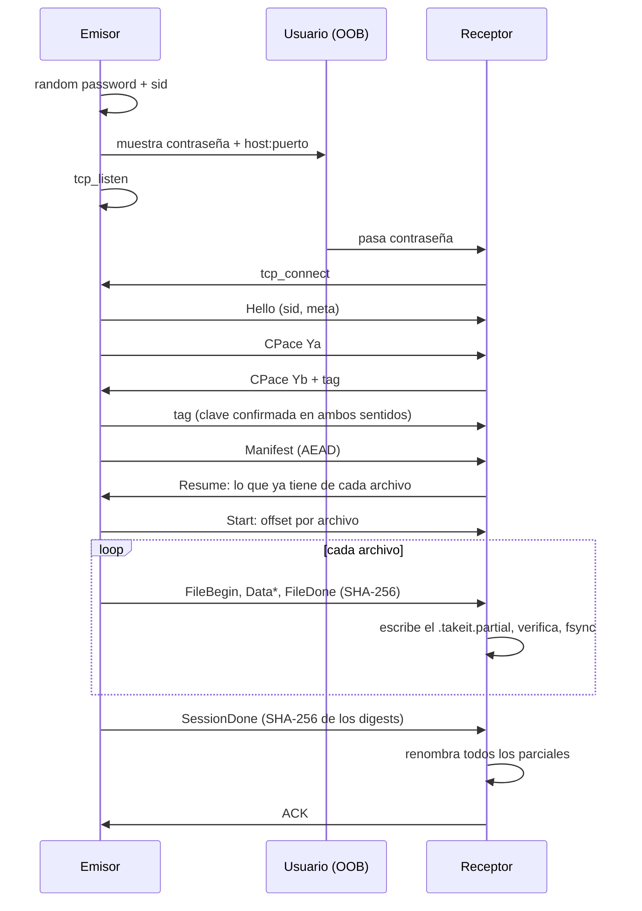

# Plan: takeit — transferencia de archivos E2E en Raylang

## Objetivo

CLI peer-to-peer: un equipo **envía** archivos o carpetas y otro **recibe** con la misma app. El canal va cifrado de extremo a extremo; al enviar se genera una **contraseña aleatoria** que el receptor debe introducir (fuera de banda: chat, voz, etc.).

## Decisiones v1 (por defecto)

| Decisión | Elección |
|----------|----------|
| Quién escucha | Emisor (`send` hace `tcp_listen`) |
| Contraseña | 8 bytes CSPRNG → hex agrupado `xxxx-xxxx-xxxx-xxxx` |
| Chunk | 256 KiB |
| Alcance | P2P directo, o a través de un rayrelay ciego (`--relay`); sin hole punching |
| I/O | Streaming: `fs.read_bytes`/`fs.seek` (M113) vía `fileread`; escritura por handle (`fs.write_bytes`) + `fs.sync` + rename atómico |
| Integridad | SHA-256 real del texto plano con el hasher incremental (M126; v1 usaba un hash encadenado) |
| Transporte | TCP crudo + AEAD de aplicación (TLS opcional más adelante) |

## Base técnica (stdlib / MCP)

| Pieza | API Raylang |
|--------|-------------|
| CSPRNG / secretos | `crypto.random_bytes` (no `std/random`) |
| AEAD | `crypto.chacha20poly1305_seal/open` (key 32 B, nonce 12 B) |
| Derivación | CPace: `crypto.x25519_shared_secret`, `crypto.sha512`, `crypto.hmac_sha512`, `std/bigint` (Elligator2); clave con `crypto.hkdf_sha256` |
| Archivos | `fs.read_file_bytes` / `fs.write_file_bytes` |
| Red | `net.tcp_listen` / `tcp_accept` / `tcp_connect` + `socket_*_bytes` |
| CLI | `args()` |
| Feedback agente | MCP `ray mcp`: `ray_check`, `ray_run`, `ray_test`, `ray_fmt`, `ray_doc` + `raylang://llms.txt` |

Nota: `socket_read_bytes` lee **un trozo**; hace falta framing por longitud + buffer de sobrante.

## UX

```text
# Emisor
takeit send ./informe.pdf
→ Contraseña: 7k9m-qp2x-lw4n-ab01
→ Esperando en 0.0.0.0:7421 …

# Receptor
takeit recv --host 203.0.113.10 --port 7421 --password 7k9m-qp2x-lw4n-ab01
→ Guardado: ./informe.pdf
```

Opciones: `--port`, `--bind`, `--out`, `--password`, `--timeout SECS` (default 120; idle en accept/lectura).

Durante la transferencia, stderr muestra progreso (`enviando`/`recibiendo` con %, velocidad y ETA).

## Modelo de amenaza y cifrado

1. **Contraseña fuera de banda** — único secreto compartido.
2. **sid público** (16 B) en el hello en claro.
3. **PAKE (v5)**: CPace (CPACE-X25519-SHA512) con PRS = contraseña, sid y el hello como ADa; `key = hkdf_sha256(sid, ISK)`. Hasta v4 era `hmac_sha256(sha256(password), salt ‖ "takeit-v1")`, que permitía probar contraseñas offline con lo capturado del auth.
4. **Payload**: frames AEAD; nonce = `contador u64 BE ‖ dirección u32 BE` (12 B; 0 = emisor, 1 = receptor: ambos cifran con la misma clave, así que cada dirección tiene su propio espacio de nonces); AAD = índice + archivo + tamaño total.
5. **Integridad**: fallo de `open` → abortar (tampering / contraseña mala).
6. **TLS** (futuro): no sustituye el E2E por contraseña.

## Protocolo (sobre TCP)

Frames: `u32 BE length` + payload. Contrato completo: [`PROTOCOL_V5.md`](PROTOCOL_V5.md).

| Fase | Contenido |
|------|-----------|
| 1. Hello (claro) | magic `TAKE`, versión 5, sid, nº de archivos, tamaño total, chunk_size |
| 2. Auth (CPace) | emisor → `Ya`; receptor → `Yb ‖ Tb`; emisor → `Ta` (confirmación de clave mutua) |
| 3. Manifest | rutas relativas + tamaños, cifrado |
| 4. Resume | receptor → emisor: por archivo, bytes que ya tiene + SHA-256 de ellos |
| 5. Start | emisor → receptor: por archivo, offset desde el que envía (el ofrecido o 0) |
| 6. Por archivo | FileBegin → Data* (solo lo que falta) → FileDone (SHA-256 del archivo completo) |
| 7. SessionDone | SHA-256 de los digests; el receptor renombra todo y responde `OK` |

## Arquitectura del código

```text
takeit/
├── docs/PLAN.md
├── ray.toml
├── src/
│   ├── main.ray          # parseo CLI, dispatch send|recv
│   ├── password.ray      # generar/normalizar contraseña
│   ├── cpace.ray         # PAKE CPace (X25519 + Elligator2)
│   ├── framing.ray       # Conn + read_exact / write_frame
│   ├── protocol.ray      # hello, manifiesto, resume/start, frames AEAD, blobs
│   ├── paths.ray         # validación de rutas del manifiesto
│   ├── sources.ray       # expansión de archivos/carpetas del emisor
│   ├── send.ray
│   ├── recv.ray
│   ├── progress.ray      # barra de progreso + map de timeouts
│   ├── streamhash.ray    # SHA-256 incremental (+ prefijo para reanudar)
│   └── fileread.ray      # lectura por trozos y rangos (fs.read_bytes/seek)
└── tests/
    ├── chunk_review_test.ray
    ├── sources_test.ray       # expansión de carpetas, enlaces, colisiones
    └── roundtrip_test.ray     # sesiones reales: 1 y N archivos, corte + reanudación, manifiestos hostiles
```

## Reanudación

Una transferencia cortada (red caída, emisor cerrado, timeout) deja en el receptor un
`<destino>.takeit.partial` por cada archivo empezado, **completos incluidos**: los archivos solo
se renombran a su sitio cuando la sesión entera se verifica. Conservarlos es seguro: cada chunk
se autentica con AEAD antes de escribirse. La siguiente sesión (otro `takeit send` de lo mismo,
contraseña nueva) los aprovecha:

1. Tras el manifiesto, el receptor ofrece por cada archivo la longitud de su parcial y su
   SHA-256 (0 si no hay, si es más largo que el archivo o con `--fresh`).
2. El emisor hashea los mismos bytes de **su** archivo: si coinciden, envía desde ahí
   (`fileread.for_each_chunk_from`); si no (otro archivo con el mismo nombre, una cola rota
   tras un corte de luz), desde 0 y el receptor trunca.
3. FileDone lleva el SHA-256 del archivo **completo**: ambos lados alimentan su hasher con el
   prefijo antes de la cola. El prefijo se lee **una vez**: el hasher que calculó la oferta (o
   la comprobación del emisor) se bifurca con `crypto.hash_clone` (raylang 1.27.64), el clon da
   el digest y el original sigue abierto hasta la cola (`streamhash.prefix` / `resume_from`).
   Como mucho `streamhash.MAX_KEPT` (1024) hashers abiertos por sesión; los archivos que pasan
   de ahí vuelven a leer su prefijo. Con 1,2 GiB reanudados de 1,5 GiB, la sesión baja de ~1,95 s
   a ~1,43 s en local.

Un parcial solo se borra si falla su verificación (digest o tamaño). El progreso cuenta lo
reanudado en el porcentaje pero no en la velocidad ni en el ETA (`progress.start_from`).

## Fases

| Fase | Qué | Estado |
|------|-----|--------|
| 0 | `ray.toml` + CLI esqueleto | ✅ |
| 1 | password + KDF + `@test` | ✅ |
| 2 | framing TCP | ✅ |
| 3 | hello + auth | ✅ |
| 4 | send/recv archivo | ✅ |
| 5 | progreso, timeouts | ✅ |
| 6 | relay / códigos cortos (`--relay` / `TAKEIT_RELAY` / relay de fábrica, vía rayrelay; código unido relay + contraseña) | ✅ (hole punching UDP: pendiente) |
| 7 | `ray build --native -o takeit --release` | ✅ (CI de releases multi-target) |
| 8 | multi-archivo (protocolo v4) | ✅ → [`PROTOCOL_V5.md`](PROTOCOL_V5.md) |
| 9 | resume de transferencia | ✅ por archivo, dentro de v4 (ver arriba) |
| 10 | PAKE (CPace) en vez de KDF de contraseña (protocolo v5) | ✅ |

## Flujo


